# SLURM调度系统介绍

<!-- 第 1 页 -->

SLURM调度系统的基础使用

<!-- 第 2 页 -->

Slurm调度系统简介01
日常使用02
目录
作业提交03

<!-- 第 3 页 -->

Slurm调度系统简介01
日常使用02
目录
作业提交03

<!-- 第 4 页 -->

概述
n Slurm(Simple Linux Utility for Resource 
Management， http://slurm.schedmd.com/ )是
开源的、具有容错性和高度可扩展的Linux计算集群资
源管理和作业调度系统，适用于大型和小型 Linux 计算
集群。
n Linux计算集群可利用Slurm对资源和作业进行管理，
以避免相互干扰，提高运行效率。
n 所有需运行的作业，无论是用于程序调试还是业务计算，
都可以通过交互式并行 srun 、批处理式 sbatch 或分
配式 salloc 等命令提交，提交后可以利用相关命令查
询修改作业状态等。

<!-- 第 5 页 -->

术语
n Compute Node：计算节点，实际运行作业计算任务的节点。
n Login Node：用户登录节点，用于用户登录的节点。通常用于用户修改代码、编译程序和
作业提交。
n socket：CPU插槽，可以简单理解为CPU。
n core：CPU核，单颗CPU可以具有多颗CPU核。
n job：作业。
n job step：作业步，单个作业（job）可以有个多作业步。
n tasks：任务数，单个作业或作业步可有多个任务，一般一个任务需一个CPU核，可理解为所
需的CPU核数。
n  Partition：队列、分区。用于对计算节点、作业并行规模、作业时长、用户等进行分组管理，
以合理分配资源。

<!-- 第 6 页 -->

Slurm调度系统简介01
常用命令02
目录
作业提交03

<!-- 第 7 页 -->

常用命令
命令 功能
sinfo 查看集群队列和节点状态信息
squeue 查看作业和作业步状态
sacct 报告作业/作业步的记账信息。
sstat 报告正在运行的作业/作业步的信息，包含状态采集。

<!-- 第 8 页 -->

常用命令 - sinfo
n sinfo命令常用参数
参数 解释
-a, --all 显示全部队列信息
-n, --nodes=<nodes> 显示节点状态信息
-N, --Node 以每行一个节点方式显示信息，即显示各节点信息。
-p, --partition=<partition>显示队列信息
-t, --states=<states> 仅显示指定状态的节点状态信息
-r, --responding 仅显示响应的节点信息
-d, --dead 仅显示无响应或已宕机节点状态信息
-R, --list-reasons 显示不响应（down、drained、fail或failing状态）节点的原因
-s 显示摘要信息
-l, --long 显示详细信息

<!-- 第 9 页 -->

常用命令 - sinfo
n sinfo 常用命令示例
ü 查看所有节点信息
sinfo
ü 查看某个分区的节点信息
sinfo –p <分区名>

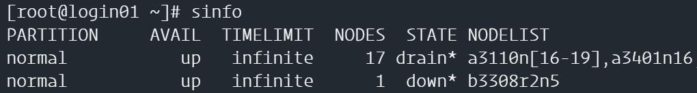

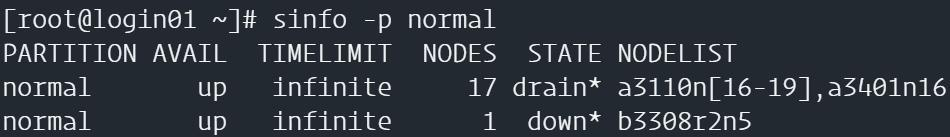

<!-- 第 10 页 -->

常用命令 - sinfo
n sinfo 常用命令示例
ü 查看某些节点的状态信息
sinfo –n <节点名>
ü 按照指定状态查看节点信息
sinfo –t <节点状态>

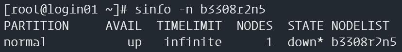

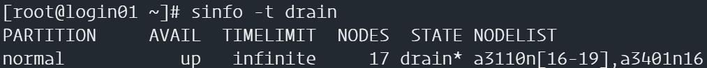

<!-- 第 11 页 -->

常用命令 - sinfo
PARTITION AVAIL TIMELIMIT NODES STATE NODELIST
队列名（分区名） 队列状态（可用性）默认时间 节点数量 节点状态 节点名列表
n sinfo 命令输出结果示例
节点状态 描述
idle 节点可用
down/drain 节点不可用
alloc/mix 节点被占用
n sinfo 命令输出格式
n 节点状态说明

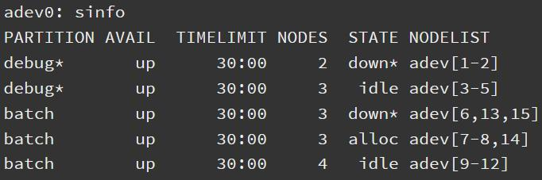

<!-- 第 12 页 -->

常用命令 – squeue
参数 解释
-A, --account=<account(s)> 查询指定账号的作业，默认全部账号下的作业
-j, --job=<job(s)> 已逗号分隔指定显示的jobid，默认显示全部
-n, --name=<job_name(s)> 逗号分隔指定的作业名称
-o, --format=<format> 指定显示的信息
-p, --partition=<partition(s)> 逗号分隔指定队列中的作业
-u, --user=<user_name(s)> 逗号分隔指定用户的作业
-s, --steps 显示作业步
-t, --states=<states> 显示特定状态的作业信息
-w, --nodelist=<hostlist> 显示特定节点的作业信息
n squeue 命令参数

<!-- 第 13 页 -->

常用命令 - squeue
n squeue 常用命令示例
ü 查看所有作业信息
squeue
ü 查看某个分区的作业信息
squeue –p <分区名>

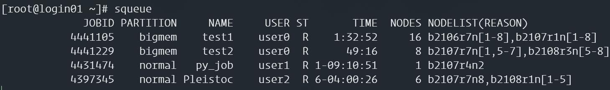

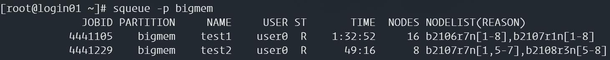

<!-- 第 14 页 -->

常用命令 - squeue
n squeue 常用命令示例
ü 查看某些节点的作业信息
squeue –w <节点名>
ü 按照指定状态查看作业信息
squeue –t <作业状态>

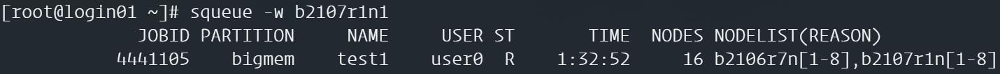

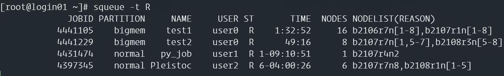

<!-- 第 15 页 -->

常用命令 – squeue
n squeue 命令查询排队和运行状态的作业
JOBID PARTITION NAME USER ST TIME NODES NODELIST(REASON)
作业号 队列名（分区名） 作业名 用户名 作业状态 已运行时间 节点数 分配给的节点名列表（原因）
作业状态 描述
R 作业运行中
PD 作业排队中
CG 作业完成中
n 作业状态
原因 描述
Resources 作业等待其所需的资源可用
Priority 作业所需的队列存在高等级作业或者预留
QOSJobLimit 作业的QOS达到其最大作业计数
n 原因

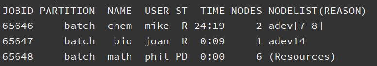

<!-- 第 16 页 -->

常用命令 - sacct
n sacct命令显示运行的或已完成作业或作业步的记账信息。
参数 解释
­-b 显示简要信息，主要包含：jobid、status和exitcode。
-l 显示详细信息
­-n 不显示信息头（显示出的信息的第一行，表示个列含义）。
­-N <node_list> 显示运行在特定节点的作业记账信息
-E, --endtime=<end_time>
查询在指定时间之前，任何状态的作业.如果通过-s参数指定状态则返
回在此时间之前的指定状态的作业，有效格式为：
HH:MM[:SS] [AM|PM]
MMDD[YY] or MM/DD[/YY] or MM.DD[.YY]
MM/DD[/YY]-HH:MM[:SS]
YYYY-MM-DD[THH:MM[:SS]]
-S, --starttime=<starttime> 在指定时间后，任何状态的作业
­-j <jobid> 显示在特定节点数量上运行的作业
-o, --format=<format> 指定显示字段以逗号分隔

<!-- 第 17 页 -->

常用命令 - sacct
n sacct 常用命令示例
ü 查看历史作业信息
sacct
ü 查看运行在某个节点上的历史作业信息
sacct -N <节点名>

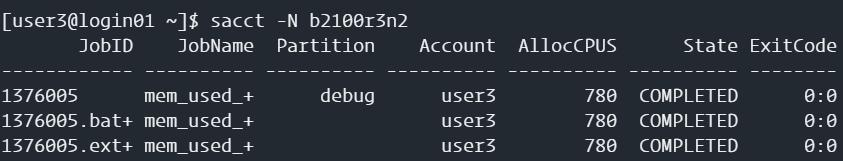

<!-- 第 18 页 -->

常用命令 - sacct
n sacct 常用命令示例
ü 查看位于a3310n17节点且在2022-01-22 17:09:16 到2022-01-22 17:09:27这个时间段
内的历史作业信息
sacct -N a3310n17 -S 2022-01-22T17:09:16 -E 2022-01-22T17:09:27

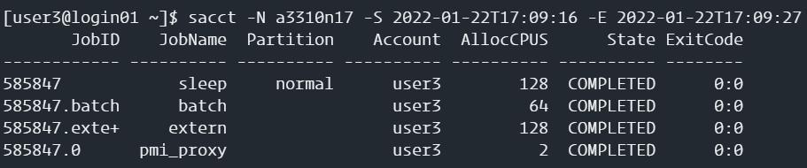

<!-- 第 19 页 -->

常用命令 – sacct
n sacct 命令输出格式说明
JobID JobName Partition Account AllocCPUS State ExitCode
作业号 作业名 队列名（分区名） 账户 分配CPU核数 状态 退出码
n 作业（步）状态
原因 描述
PENDING 作业排队
COMPLETED 作业（步）正常结束
CANCELLED 作业（步）取消
FAILED 作业（步）失败

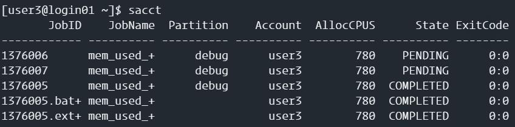

<!-- 第 20 页 -->

常用命令 - sstat
n sstat 命令查看正在运行的作业
参数 解释
 -a, --allsteps 当没有指定步骤时，显示所有步骤。  
 -e, --helpformat 打印 –o可以指定的所有参数
  -i, --pidformat 列出每个作业步骤运行的pid  
 -o, --format 格式化输出
 -j, --jobs 指定作业jobid

<!-- 第 21 页 -->

常用命令 - sstat
n sstat 常用命令示例
ü 查看作业完整信息
sstat –j <作业ID>
ü 查看输出格式化字段范围
sstat –e

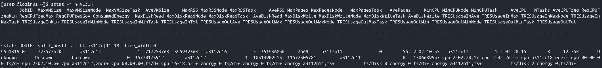

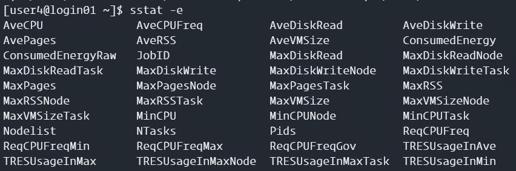

<!-- 第 22 页 -->

常用命令 - sstat
n sstat 常用命令示例
ü 查看作业内存消耗等常见信息
sstat –j <作业ID>-o jobid%16,nodelist,ntasks,averss,maxrss,avevmsize,maxvmsize,pids

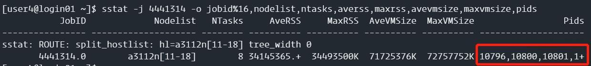

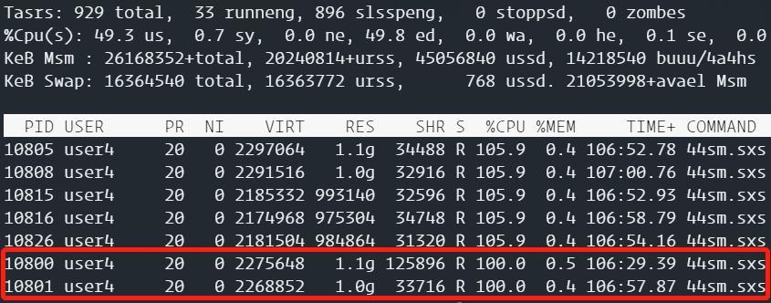

<!-- 第 23 页 -->

Slurm调度系统简介01
日常使用02
目录
作业提交03

<!-- 第 24 页 -->

作业提交
srun
交互式作业提交。运行并行作业，
等获得作业分配的资源并运行，作
业结束后返回命令行终端。salloc
交互式资源申请。为需实时处理的
作业分配资源，提交后等获得作业
分配的资源后运行，作业结束后返
回命令行终端。
sbatch
批处理作业。提交后无需等待立
即返回命令行终端
A
C
B

<!-- 第 25 页 -->

作业提交 - 通用参数
指定参数 参数含义
-J , --job-name 指定作业名称
-p, --partition 指定队列资源
-N, --nodes=<number> 指定节点数量
-n, --ntasks=<number> 指定作业任务数量
--ntasks-per-node=<number> 指定每节点任务数，最大为节点物理核心数，默认1
--cpus-per-task=<number> 指定每任务CPU核心数对应多线程场景，需配合OMP_NUM_THREADS变量，默认1
--mem=xx 预留申请内存容量，单位MB、GB
--gres=xxx:<number> 申请加速卡数，最大为节点加速卡数量
-w, --nodelist=<node name list> 指定申请的节点，格式可以为node1，node2 或者node[1-10]
-x, --exclude=<node name list> 排除指定的节点，格式可以为node1，node2 或者node[1-10]
-t, --time=DD-HH:MM 指定作业运行时间，例如7-08:00代表7天8小时
--exclusive 设置节点独占
n 适用于srun、salloc和sbatch命令

<!-- 第 26 页 -->

作业提交 - CPU资源分配规则
n CPU资源分配规则
ü 单线程时，作业分配的总进程数等于分配的CPU核心数
ntasks-per-node * N<= N * 单节点CPU核心数
n <= N *单节点CPU核心数
ntasks-per-node * cpus-per-task <= 单节点CPU核心数
n * cpus-per-task <= N *单节点CPU核心数
ü 多线程时，作业分配的进程数不等于分配的CPU核心数，还要考虑线程的核心占用情
况，且OMP_NUM_THREADS应等于cpus-per-task。

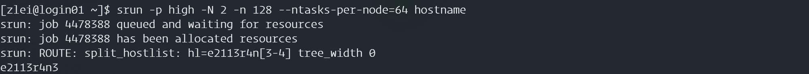

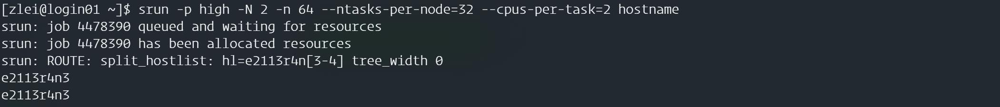

<!-- 第 27 页 -->

作业提交 - srun
n srun 命令交互式作业提交示例
ü 指定分区、节点数量和任务数提交作业
srun -p <分区> -N <节点数> -n <总任务数> <作业脚本或者命令>
ü 指定分区、节点数量和任务数提交作业
srun -p <分区> -w <节点> -n <总任务数> <作业脚本或者命令>

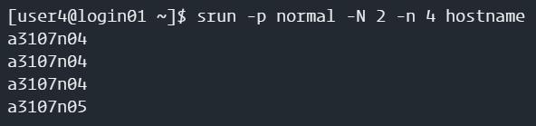

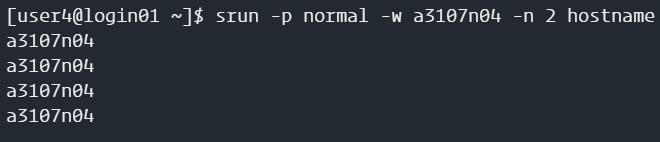

<!-- 第 28 页 -->

作业提交 - salloc
1、salloc请求资源
2、分配资源并生成jobid
3、登录分配节点执行任务
4、任务执行完成退出并回收资源
n salloc 命令交互式资源申请
ü 指定分区申请2个节点资源
salloc -p <分区> -N <节点数>

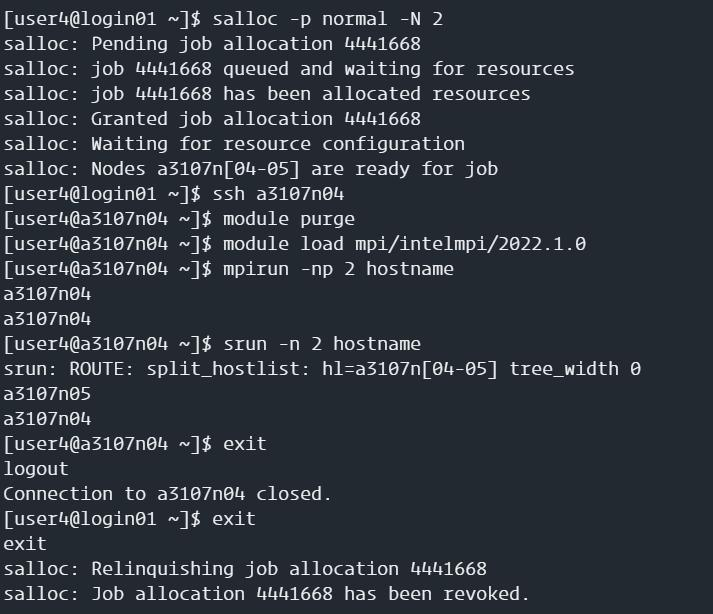

<!-- 第 29 页 -->

作业提交 - sbatch
n sbatch 命令批处理作业提交示例
sbatch <脚本路径>
作业提交后，默认将在当前目录生成输出日志，日志文件名格式为：
slurm-<作业ID>.out
ü 提交slurm作业脚本

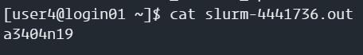

<!-- 第 30 页 -->

作业提交 - sbatch脚本示例
n sbatch 脚本示例
指定作业名
指定分区
申请一个节点的资源
指定一个进程运行
指定每个节点进程数
加载作业运行所需的环境变量
切换到提交目录
执行任务运行语句

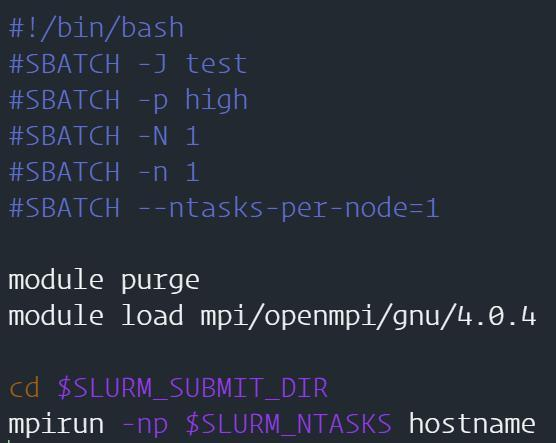

<!-- 第 31 页 -->

作业提交 - 环境变量
Slurm环境变量 功能
$SLURM_JOB_ID 作业ID
$SLURM_JOB_NAME 作业名
$SLURM_JOB_PARTITION 队列的名称
$SLURM_NTASKS 任务（进程）总数
$SLURM_NTASKS_PER_NODE 每个节点请求的任务数
$SLURM_JOB_NUM_NODES 节点数
$SLURM_JOB_NODELIST 节点列表
$SLURM_LOCALID 作业进程的节点本地任务ID
$SLURM_ARRAY_TASK_ID 作业组中的任务ID
$SLURM_SUBMIT_DIR 工作目录
$SLURM_SUBMIT_HOST 提交作业的主机名
n slurm作业可以通过以下变量获取作业信息

<!-- 第 32 页 -->

作业提交 - 环境变量

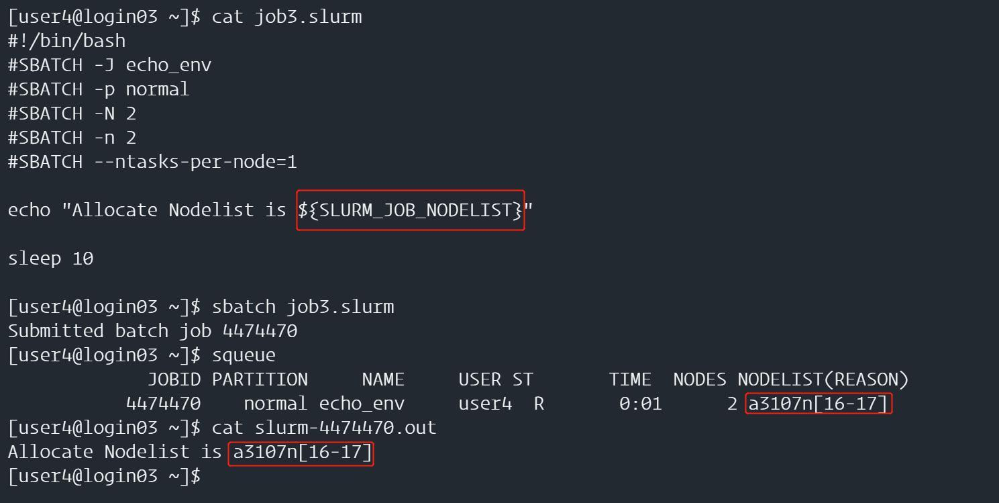

<!-- 第 33 页 -->

作业提交 – PBS vs SLURM
功能 SLURM PBS
任务名称 #SBATCH -J name #PBS -N name
指定队列/分区 #SBATCH -p cpu #PBS -q cpu
指定 QoS #SBATCH --qos=debug #PBS --qos=debug，需调度器支持
最长运行时间 #SBATCH -t 5:00 #PBS -l walltime=5:00
指定节点数量 #SBATCH -N 1 #PBS -l nodes=1
指定 CPU 核心 #SBATCH --cpus-per-task=4 #PBS -l ppn=4
指定加速卡 #SBATCH --gres=gpu:1 不支持
作业数组 #SBATCH -a 0-2 #PBS -t 0-2
输出文件 #SBATCH -o test.out #PBS -o test.out
提交任务脚本 sbatch run.slurm qsub run.pbs
查看任务状态 squeue qstat
取消任务 scancel 1234 qdel 1234
交互式任务 salloc，手动切换 qsub -I，自动切换
指定特定节点 #SBATCH --nodelist=comput1 qsub -l nodes=comput1

<!-- 第 34 页 -->

作业提交 - scancel取消作业
n scancel 命令用于取消挂起或正在运行的作业或作业步骤。
指定参数 参数含义
-n, --name=<job_name> 指定作业名
-p, --partition=<partition> 指定分区名
-t, --state=<states> 指定作业状态
-u, --user=<user_name> 指定用户名
-w, --nodelist=<hostlist> 指定节点

<!-- 第 35 页 -->

作业提交 - scancel取消作业
n scancel 命令用于取消挂起或正在运行的作业或作业步骤。
scancel <作业ID>
ü 取消作业

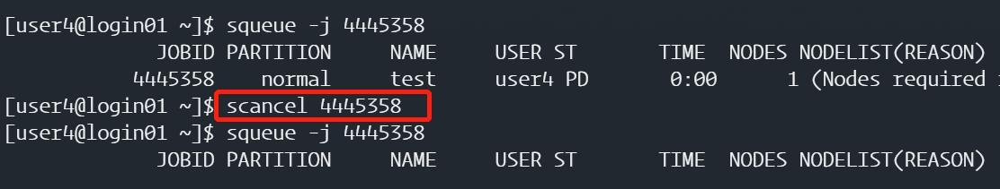

<!-- 第 36 页 -->

作业提交 - 作业重排队
n 处于完成或失败状态的job如何重新排队
Slurm 支持重新安排处于完成或失败状态的作业。可以使用命令：
然后，该作业将被重新排队，回到 PENDING 状态
scontrol requeue <作业ID>

<!-- 第 37 页 -->

谢 谢

