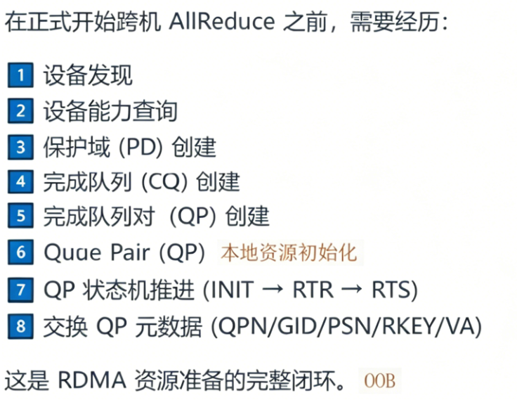
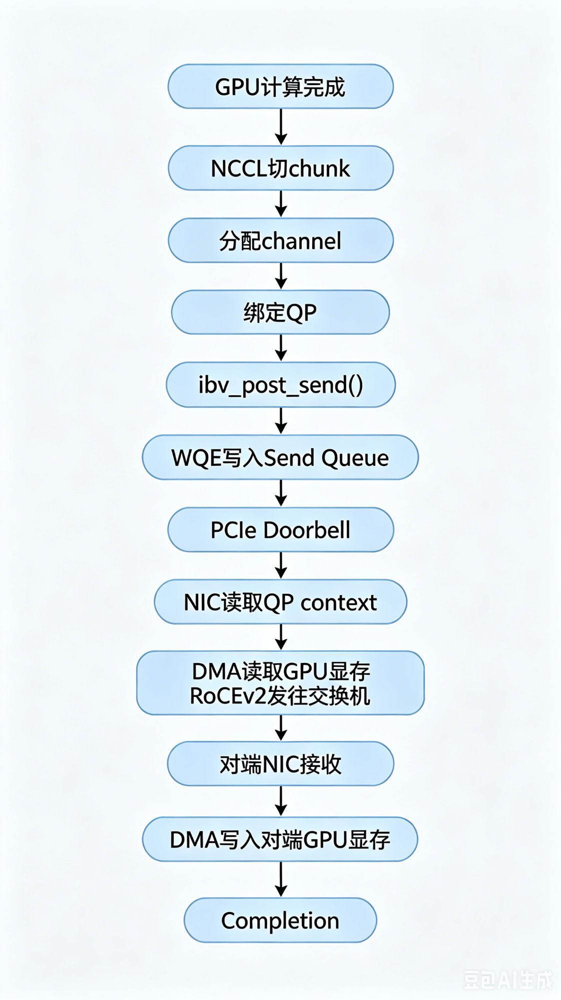

# 算力网络通信全路径

<!-- 第 1 页 -->

算力网络通信全路径 
 模型分布式训练策略   并⾏训练⽅式 
 数据并行 DP   单机训练 
 模型并行 MP 
 流水线并线 PP 
 张量并行 TP--- 要 all-reduce---all to all 
 专家并行 EP-- 
 3D 并行  TP+PP+DP 
 GPU 梯度计算（梯度是临时经验） 5
 NCCL 通信调度环（控制平面） --- 重要
 性占⽐ 40%  ···
 RDMA 资源环 --- 占比 30% 
 RDMA 资源准备 --- 控制平面
 资源名称及说明  8
 NCCL 调用资源  1
 跨机 All Reduce 资源准备阶段  
 准备步骤 
 阶段 1--- 设备发现及能⼒查询   把 “ 网卡硬件 ” 抽象成  userspace 可操作对象
 阶段 2---PD 创建   创建一个资源隔离域  绑定 QP MR 保证 QP 访问同 PD 内存区  ，  形成 RDMA 的  Namespace 
 阶段 3---CQ 创建   本质作用是：把 “ 硬件完成事件 ” 通知给软件。
 阶段 4---QP 创建   在网卡硬件里开辟一个 “ 通信管道 ”
 阶段 5---MR 创建   把  GPU/Host 内存变成  NIC 可  DMA 访问的对象
 阶段 6---QP 状态机推进   QP 状态机在推进到  RTS 之前，必须知道对端的   QPN 等信息 
 阶段 7--- 元数据交换   RDMA 链接的 “ 信令平面 ” （转发平面）
 阶段 8--- 资源准备完成后， NIC 内部是什么状态 
 两台机器  一次完整的  RDMA 数据通信过程 
 Step 1: A 发起  ibv_post_send()   把 WQE 被写入 SQ ( 发送队列 ) 然后 doorbell 通 知  NIC
 Step 2: NIC 开始  DMA   从本地内存  DMA 读数据 --- 》从本地内存  DMA  读数据 --- 》  发到网络  （ CPU 不参与）
 Step 3: 数据到达  B   B 的  NIC ：检查  rkey-- 》检查  remote addr  -- 》 DMA 写入内存（仍然不打扰  CPU ）
 Step 4: CQ 完成通知   当 A 的 NIC 完成发送后它会生成 1 个 CQE 并写入   send CQ
 RDMA 操作类型
 Send and Receive 
 RDMA Write AI 训练中使用率 99% 
 RDMA Read 
 RDMA 传输服务 --- 在建立  QP 时选择传输服务，
 QP 是 RDMA 的基本通信单元 
 RC （可靠连接）千卡及以下集群推荐使⽤ RC 
 99% 
 UC （不可靠连接） 
 UD （不可靠数据报）
 DC （动态连接）万卡集群推荐使⽤ DC 
 ⼀次 AllReduce 的通信过程拆解 
 1. GPU 计算与数据切分 
 2. Channel 分配与 QP 绑定 
 3. 任务下发与数据封装 
 4. 数据传输与节点内通信总结 
 ⼀次 AllReduce 的通信过程拆解图
 拆解图
 RoCE 拥塞控制环 --- 占比 30% 46
 可观测性 21
 MFU 提升 - 提⾼ GPU 集群的利⽤率

