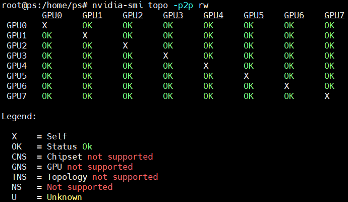

# 4090、5090开启p2p教程

## 4090、5090开启p2p教程

### 一、安装用户态驱动

下载地址：https://www.nvidia.com/en-us/drivers/details/245523/

安装命令：./NVIDIA-Linux-x86_64-570.148.08.run --no-kernel-modules

### 二、安装cuda-toolkit

下载地址：https://developer.nvidia.com/cuda-12-8-0-download-archive?target_os=Linux&target_arch=x86_64&Distribution=Ubuntu&target_version=22.04&target_type=runfile_local

### 三、安装open-gpu-kernel-modules

下载地址：https://github.com/tinygrad/open-gpu-kernel-modules/tree/570.148.08-p2p

执行脚本安装

### 四、检查是否安装成功

nvidia-smi topo -p2p rw

> 本文档含 1 张插图，见 `assets/4090、5090开启p2p教程/`。

