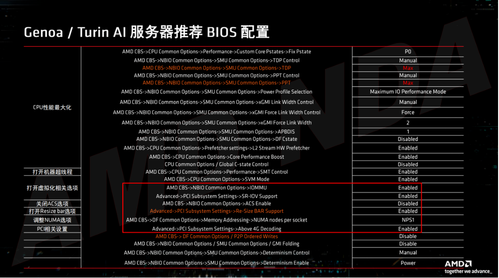

# 6A15X3机型测试NCCL

<!-- 第 1 页 -->

1、
2、
3、
4、
5、
6、
●
●
●
●
确保安装过程输出无报错，如有报错联系供应商。
NV P2P NVIDIA-Linux-x86_64-580.82.09-CKS-20260316.run安装 消费卡 驱动 ：
bash NVIDIA-Linux-x86_64-580.82.09-CKS-20260316.run
NV后续选择按 驱动正常选择即可。安装完成后重启设备。
nccl-test安装 测试程序：
NCCL RCCL参照《 和 测试指南》进行编译与安装：
nccl nccl-test需先编译与安装 项目，再编译与安装 项目。
6A15 X3 机型运行性能测试前置操作：
Disable_ACS.sh ACS P2P需运行 禁用 ，确保卡间可以进行 通信。重启后失效，
需开机运行。
66AA1155  XX33 NNCCCCLL机机型型测测试试
~/.bashrc在环境变量中添加以下环境变量到 文件末尾。
export NCCL_P2P_LEVEL=SYS
BIOS 6设置：确保以下红框内 个选项设置正确
安装驱动编译依赖项：
yum yum install -y make gcc grubby kernel-devel-$(uname -r)命令：
apt apt install -y build-essential linux-headers-$(uname -r) grubby命令：
brcm_switch 6.X安装 驱动（暂不支持 以上内核）：
install.shbash 解压安装包，执行：

<!-- 第 2 页 -->

7、
8、
export NCCL_MIN_NCHANNELS=32
nccl-test 测试参考命令：
16 卡：
NCCL_P2P_LEVEL=SYS NCCL_MIN_NCHANNELS=32 ./alltoall_perf -b 1m -e 2g -f 
2 -g 16
8 卡：
CUDA_VISIBLE_DEVICES=0, 1, 4, 5, 8, 9, 12, 13  NCCL_P2P_LEVEL=SYS 
NCCL_MIN_NCHANNELS=32 ./alltoall_perf -b 1m -e 2g -f 2 -g 8
6A15 X3 NCCL机型 性能参考值：
单机 all reduce
单机 all gather
单机 reduce_scatter
单机 send_receive
单机 all to all
16 卡
50.13
49.55
49.57
42.52
41.15
8 卡
50.05
49.65
49.54
42.62
50.62
4 卡
49.42
46.06
47.22
42.9
44.3
2 卡
51.27
50.99
50.89
44.56
30.69

