# AMD显卡测试报告

## AMD显卡测试报告

| 配置 | 型号 | 数量 |
|---|---|---|
| 处理器 | Threadripper PRO 5975WX | 2 |
| 显卡 | AMD Radeon AI PRO R9700 | 8 |
| 内存 | 三星 RECC DDR4 32GB 3200MHz | 16 |
| 硬盘 | PM893 SATA 960G | 1 |
| 网卡 | 云尖 Intel i350-AM4 四口千兆 | 1 |
| 主板 | 同泰怡 TG659V2 4U | 1 |

### 一、AMD驱动和Rocm安装

amdgpu安装完毕：

Rocm已安装完毕：

### 二、显卡压力测试

使用工具：https://github.com/ROCm/HIP-Examples

测试完毕，功耗正常，温度正常，无明显异常：

### 三、ImageNet模型训练

使用工具：https://github.com/pytorch/examples

模型：resnet

模型深度：18层

数据集：dummy

epoch数量：5

显卡调用正常，Pytorch等依赖库兼容正常。

训练总耗时：59m55s

显卡训练时状态

大模型训练输出

### 四、模型推理性能测试

使用模型：qwen3.5-122B-A10B-FP8

模型参数量：122B

对接工具：openweb-ui

测试结果：单并发场景，峰值96tokens/s

### 五、模型推理压力测试

单并发压力测试：55.56 tokens/s     平均带宽：55.56 tokens/s

10并发压力测试：233.95 tokens/s    平均带宽：23.40 tokens/s

50并发压力测试：739.45 tokens/s    平均带宽：14.79 tokens/s

100并发压力测试：1048.41 tokens/s  平均带宽：10.48 tokens/s

200并发压力测试：1193.39 tokens/s  平均带宽：6 tokens/s

单并发

10并发

50并发

100并发

200并发

> 本文档含 12 张插图，见 `assets/AMD显卡测试报告/`。

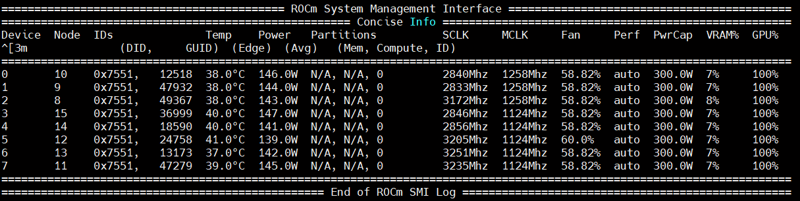

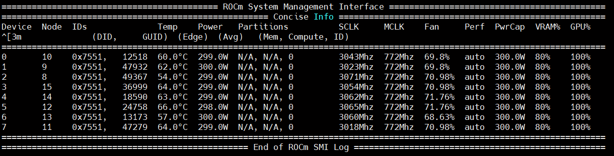

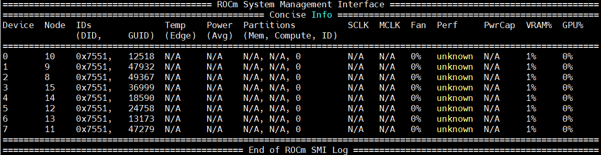

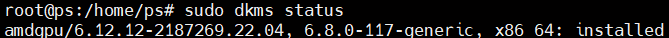

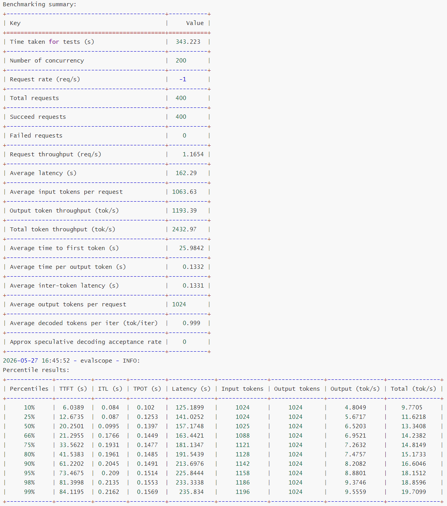

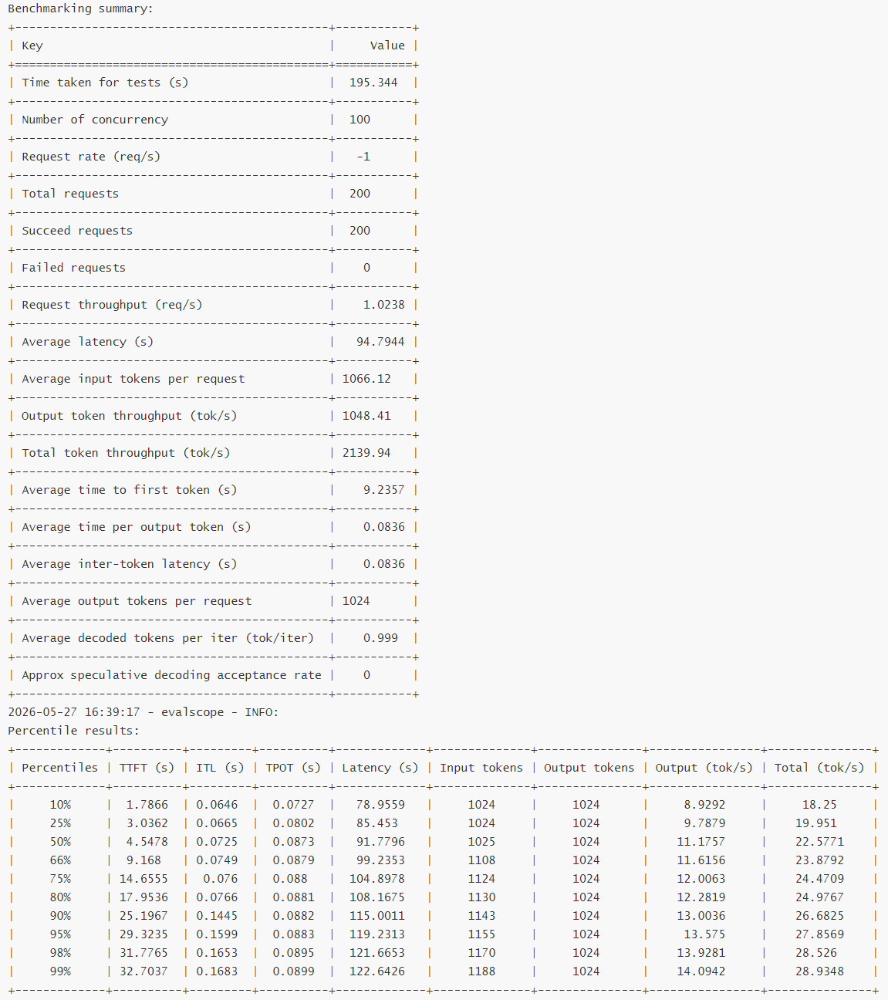

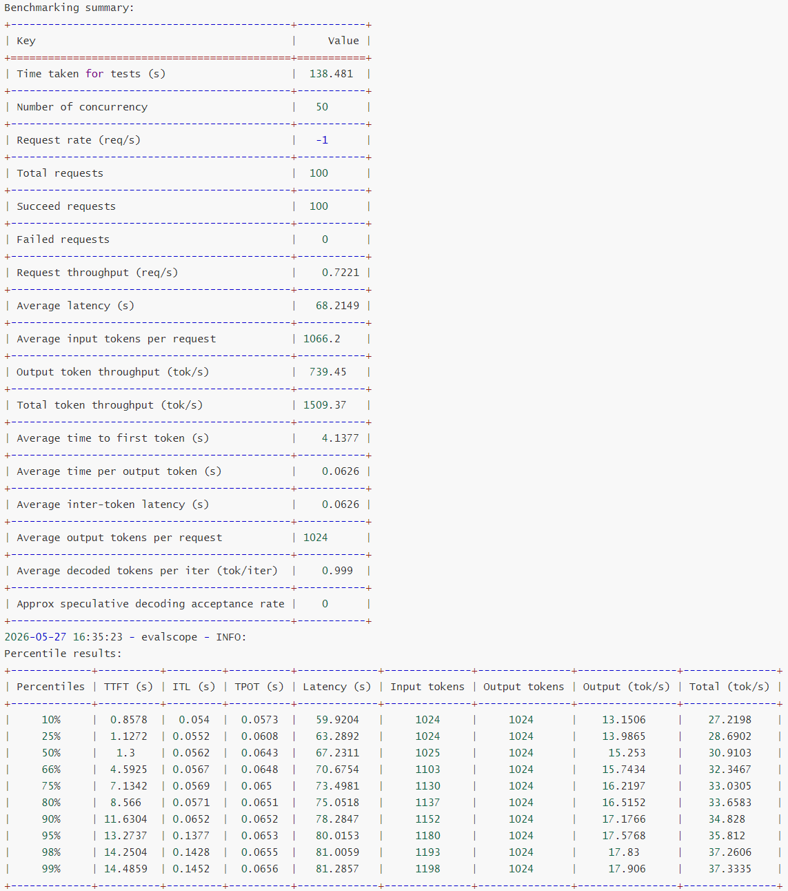

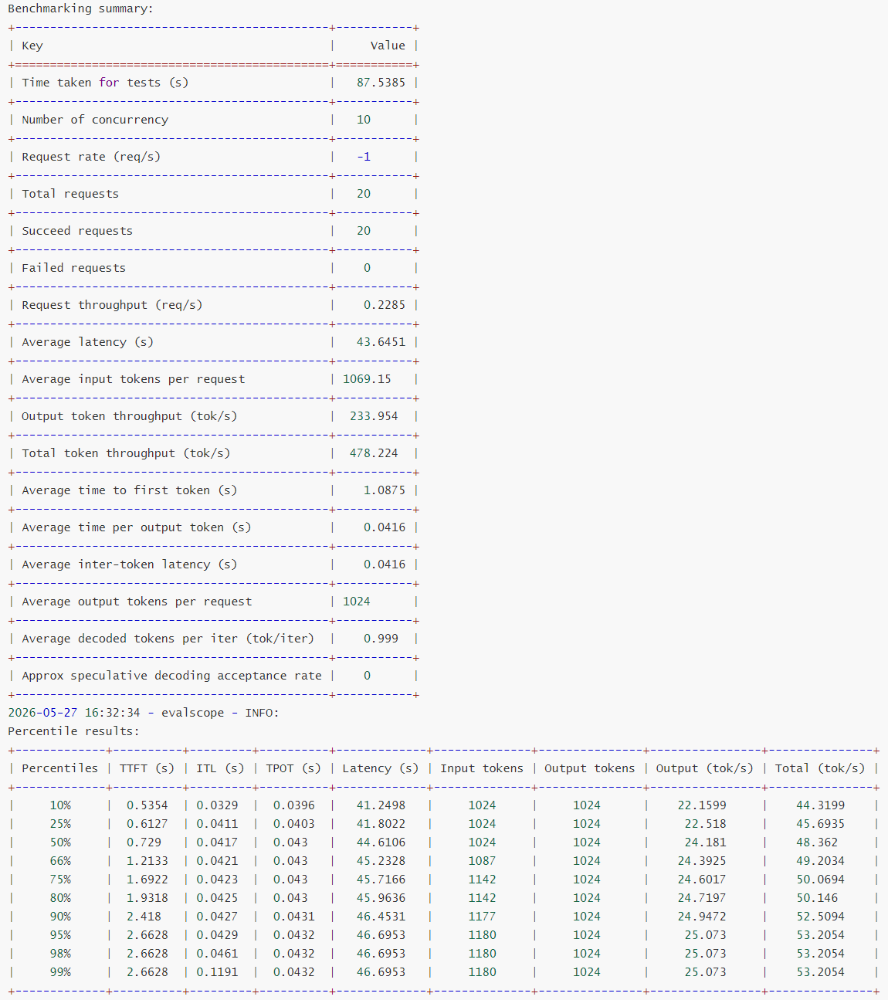

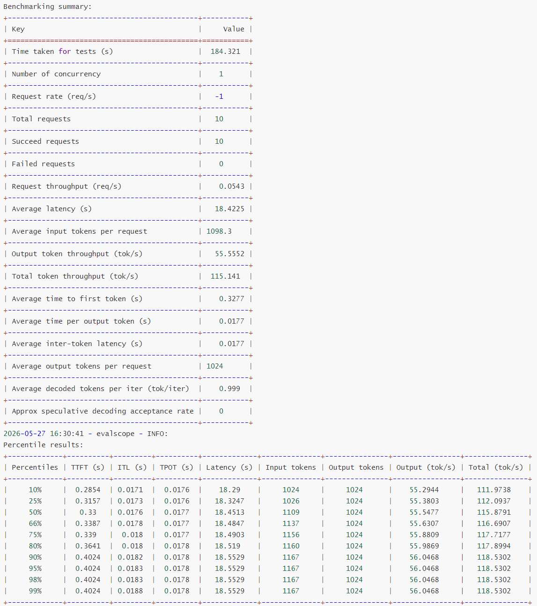

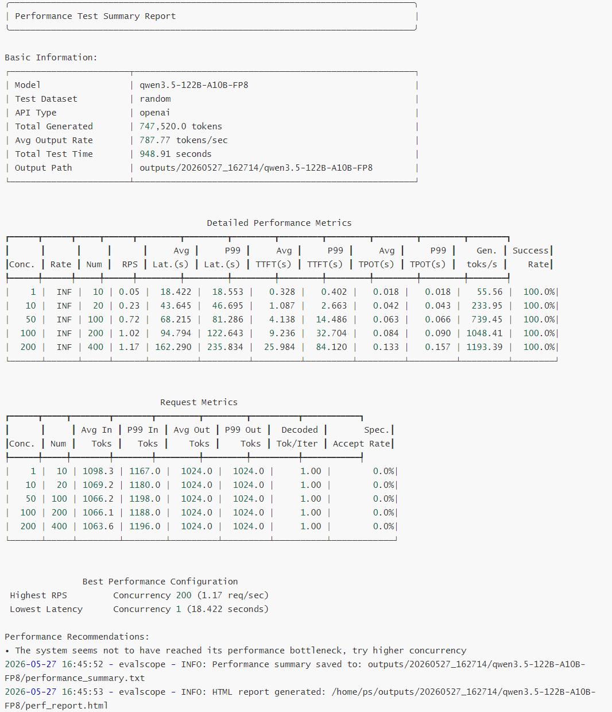

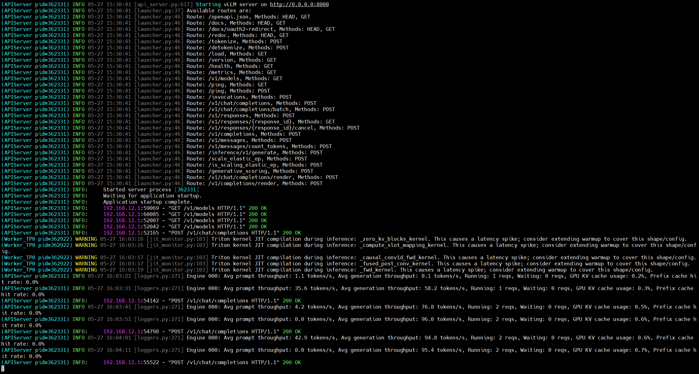

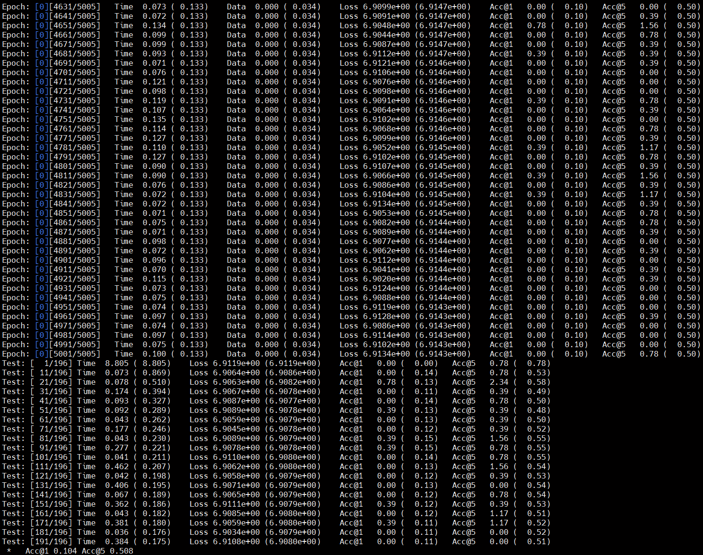
