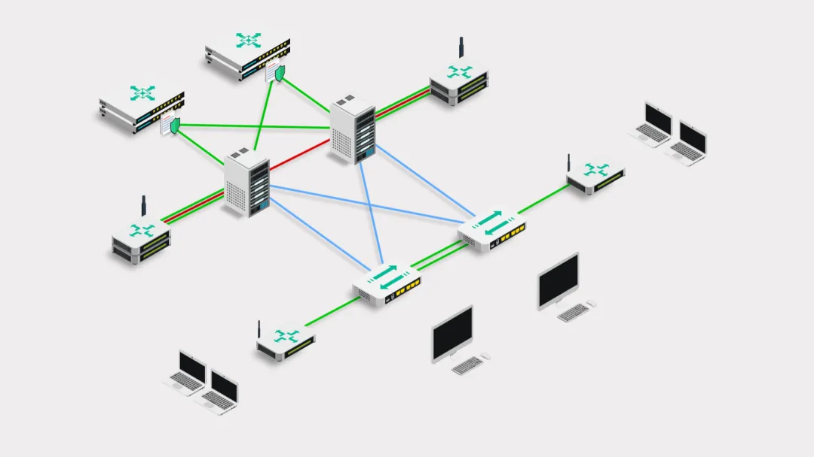

# Slurm任务调度系统教学

<!-- 第 1 页 -->

HPC JOB 
SCHEDULER
Slurm
任务调度系统
简明教学指南
掌握⾼性能计算集群管理的核⼼⼯具
从基础命令到进阶应⽤的完整学习路径
集群管理 作业调度 资源优化

<!-- 第 2 页 -->

⽬录
01背景与概述
了解Slurm的起源、架构与核⼼概念，理解其在⾼性能计算领
域的地位和作⽤
02核⼼作⽤与价值
深⼊探讨Slurm为⽤户提供的实际价值，包括资源管理、作
业调度和性能优化
03基础使⽤⽅法
掌握Slurm最常⽤的命令和作业提交⽅式，从简单命令到复
杂脚本编写
04使⽤细节与进阶功能
学习作业脚本编写技巧，探索作业依赖、数组任务等进阶功
能提升效率

<!-- 第 3 页 -->

01
背景与概述
了解Slurm的起源、架构与核⼼概念
理解其在⾼性能计算领域的地位和作⽤

<!-- 第 4 页 -->

什么是 Slurm?
Simple Linux Utility for Resource Management
定义与特点
Slurm是⼀个 开源、可扩展、⾼容错 的集群管理和作业调度系统，专为Linux集
群设计。
免费开源，遵循GPL通⽤公共许可证
⾼度可扩展，⽀持数百万处理器核⼼
⾏业地位
被全球超级计算机和计算集群⼴泛采⽤，是⾼性能计算领域的事实标准。
Top500多台使⽤ 2016前⼗名5台
核⼼架构组件
slurmctld
主控服务，负责故障切换、资源监控、队列管理和作业调度
slurmd
计算代理，负责启动任务和监控任务执⾏，⽀持分层通信
slurmdbd
记账存储服务，负责记账数据和配置信息的存储
各组件协同⼯作，提供完整的集群管理和作业调度功能

<!-- 第 5 页 -->

核⼼概念与术语
理解Slurm的资源模型和交互⽅式
节点
Node 是集群的基本计算单元，可以是物理服务器或
虚拟机
计算节点
管理节点
存储节点
分区
Partition 是节点的逻辑分组，可视为作业队列
不同硬件配置
访问权限控制
时间限制差异
资源
Resource 作业运⾏所需的CPU、内存、GPU等
CPU核⼼
内存
GPU
作业层级结构
Job
作业
完整任务
Step
作业步骤
⼦任务
Task
任务
执⾏单元

<!-- 第 6 页 -->

02
核⼼作⽤与价值
理解Slurm为⽤户提供的实际价值
资源管理、作业调度和性能优化

<!-- 第 7 页 -->

Slurm 的核⼼价值
为什么选择Slurm作为集群⼯作负载管理器
资源统⼀管理
将分散的计算资源整合为统⼀的资源池，实现 单⼀
系统映像
避免资源冲突和浪费
简化⽤户访问接⼝
提⾼集群利⽤率
智能调度算法实现 公平⾼效的资源分配
基于优先级的队列管理
⾃动负载均衡
并⾏计算⽀持
原⽣⽀持 MPI、OpenMP 等并⾏计算框架
分布式内存管理
多节点协同计算
完整⽣命周期管理
从作业提交到完成的全流程管理，包括 监控和记账
实时监控作业状态
详细的使⽤统计
深度硬件控制
对硬件资源的 精细化控制 能⼒
CPU亲和性设置
GPU分⽚和⽹络拓扑
访问控制与优先级
灵活的 ⽤户访问控制 和优先级管理
基于⽤户组的权限控制
QoS服务质量管理

<!-- 第 8 页 -->

03
基础使⽤⽅法
掌握Slurm最常⽤命令和作业提交⽅式
从简单命令到复杂脚本编写

<!-- 第 9 页 -->

作业提交的三种⽅式
选择最适合的提交⽅式提⾼⼯作效率
srun
交互式作业
将当前要运⾏的命令提交到计算节点上运⾏， 即时
执⾏、即时查看结果
适⽤场景
短时间测试任务
需要即时查看输出
调试和排错
示例
srun -N 1 -n 4 hostname
sbatch
批处理作业
提交作业脚本到后台运⾏， 最常⽤⽅式 ，不受⽹络
波动影响
适⽤场景
⻓时间运⾏任务
复杂的多步骤⼯作流
⽣产环境作业
示例
sbatch my_job.sh
salloc
资源分配
分配资源后获取交互式shell， 适合交互式开发
适⽤场景
交互式开发调试
需要⼿动操作的环境
探索性数据分析
示例
salloc -N 2 -n 8
执⾏时间
短 ➜ ⻓
复杂度
简单 ➜ 复杂
⽹络依赖
⾼ ➜ 低

<!-- 第 10 页 -->

sbatch 批处理作业详解
编写规范的作业脚本是Slurm使⽤的核⼼技能
作业脚本基本格式
#!/bin/bash
#SBATCH --job-name=test
#SBATCH --partition=cpu
#SBATCH --nodes=2
#SBATCH --ntasks-per-node=4
#SBATCH --time=2:00:00
srun python my_script.py
优先级规则
命令⾏选项会 覆盖 脚本中的 #SBATCH 指令。
sbatch --partition=gpu myjob.sh
⬆
 即使脚本指定cpu分区，也会使⽤gpu分区
常⽤参数详解
--job-name 作业名称
显示在squeue中，便于识别
--partition 分区名
指定作业提交的分区
--nodes 节点数
申请的最⼩和最⼤节点数
--ntasks-per-node 每节点任务数
每个节点运⾏的任务数量
--time 运⾏时间
格式: minutes 或 hours:minutes
--mem / --mem-per-cpu 内存申请
单位可为K, M, G, T

<!-- 第 11 页 -->

常⽤命令⼀览
掌握这些命令即可⾼效使⽤Slurm
sinfo
查看集群状态和分区信息
sinfo
sinfo -N
查看节点状态: idle(空闲) / alloc(已分配) / mix(部分占⽤)
squeue
查看作业队列状态
squeue
squeue -u user
作业状态: PD(排队) / R(运⾏) / CG(完成中)
scancel
取消已提交的作业
scancel 12345
scancel -u user
可通过作业ID或⽤户名取消作业
scontrol
查看和修改作业参数
scontrol show job 123
查看作业详细信息，可修改排队作业参数
sacct
查看历史作业信息
sacct -j 123
查看已完成作业的详细信息和资源使⽤
sreport
⽣成使⽤报告
sreport cluster utilization
⽣成集群、⽤户、账户的资源使⽤统计

<!-- 第 12 页 -->

04
使⽤细节与进阶功能
提升Slurm使⽤效率的进阶技巧
作业脚本编写、依赖关系和数组任务

<!-- 第 13 页 -->

作业脚本编写技巧
实⽤的脚本编写技巧和最佳实践
环境配置
模块加载
module load gcc/9.3.0
module load python/3.8.5
环境变量
export OMP_NUM_THREADS=$SLURM_CPUS_PER_TASK
作业信息环境变量
$SLURM_JOB_ID
作业ID
$SLURM_JOB_NODELIST
节点列表
$SLURM_NTASKS
任务总数
$SLURM_CPUS_PER_TASK
每任务CPU数
输出⽇志管理
使⽤动态⽂件名避免覆盖:
#SBATCH --output=%x_%j.out
%x = 作业名, %j = 作业ID
独⽴错误⽇志:
#SBATCH --error=logs/job_%j.err
完整脚本示例
#!/bin/bash
#SBATCH --job-name=data_analysis
#SBATCH --partition=compute
#SBATCH --nodes=1
#SBATCH --ntasks-per-node=8
#SBATCH --time=04:00:00
#SBATCH --output=logs/%x_%j.out
module load python/3.8
export OMP_NUM_THREADS=8
srun python analyze.py --input data.csv

<!-- 第 14 页 -->

进阶功能概览
⼤幅提升⼯作效率和任务⾃动化⽔平
作业依赖
通过 --dependency 设置作业间依赖，实现 流⽔线式任务处理 。
# 作业A完成后启动作业B
sbatch --dependency=afterok:12345 jobB.sh
afterok:jobid - 成功后执⾏
after:jobid - 开始后执⾏
作业数组
通过 --array 批量提交相似任务，提⾼效率和资源利⽤率。
#SBATCH --array=1-100:2%5
# 1到100，步⻓2，同时运⾏5个
使⽤ $SLURM_ARRAY_TASK_ID 区分任
务
适⽤于参数扫描、批量处理
GPU资源申请
通过 --gres=gpu:N 申请GPU资源。
#SBATCH --gres=gpu:2
QoS与优先级
通过 --qos 指定服务质量等级，调整作业优先级。
#SBATCH --qos=high
记账与统计
使⽤ sreport ⽣成资源使⽤报告。
sreport user top

<!-- 第 15 页 -->

开始使⽤ Slurm 
核⼼要点
理解Slurm的架构和核⼼概念
掌握三种作业提交⽅式的特点
熟练使⽤常⽤命令监控管理作业
探索进阶功能提升⼯作效率
学习路径
1从简单的srun命令开始尝试
2 逐步学习编写sbatch脚本
3 探索依赖和数组等⾼级功能
官⽅⽂档
slurm.schedmd.com
社区⽀持
邮件列表和论坛
实践练习
多动⼿是最佳途径
实践 是掌握Slurm的最佳途径，开始你的⾼性能计算之旅吧！

