# 标品大模型测试笔记

GPU服务器大模型标品测试笔记

机型：4×NVIDIA RTX PRO 5000 Blackwell（约48GB×4） | 测试日期：2026-11

## 1. 测试目的与选型逻辑

本次测试用于服务器作为大模型推理标品的交付验证，重点不是比模型“智商”，而是验证：能跑多大模型、多快、多稳、推荐怎么用。

选型采用「1个主力 + 1个对照」：

• 模型A：Qwen3.5-35B-A3B-FP8 —— 同代MoE多模态中的高效档，显存余量大，适合并发与长上下文。

• 模型B（对照/展示）：Qwen3.5-122B-A10B-FP8 —— 更大总参MoE，能力展示与上限验证，显存更紧，并发需降。

测试分层：硬件底座（拓扑/带宽/NCCL）→ 应用层（API+EvalScope常规）→ 极限抽测 → 图形/框架补充（glmark、PyTorch MNIST）。

## 2. 硬件底座结果

### 2.1 GPU识别与拓扑

4卡均识别为RTX PRO 5000 Blackwell；拓扑为NODE（同NUMA内PCIe），无NVLink。多卡可跑，但卡间通信走PCIe，预期NCCL带宽低于NVLink机型。

图1 nvidia-smi 四卡状态

图2 GPU互联拓扑（NODE / 无NVLink）

### 2.2 显卡带宽（nvbandwidth）

主机↔显卡：H2D约57.8GB/s/卡，D2H约58.0GB/s/卡，波动很小，判定通过。

图3 显存/主机带宽测试截图

### 2.3 多卡通信（NCCL）

4卡all-reduce平均busbw约20.5GB/s（1G约20.64GB/s。

图4 NCCL all_reduce_perf 结果

### 2.4 图形跑分（glmark2）

OpenGL综合分 9920（800×600窗口），作为图形能力补充项，不与大模型tok/s混比。

图5 glmark2 Score: 9920

## 3. 显存占用、预留与最优使用（重点）

整机显存：48GB × 4 ≈ 192GB。vLLM用 --gpu-memory-utilization 控制引擎可用显存比例，剩余作为预留。

| 项目 | 模型A 35B-A3B-FP8 | 模型B 122B-A10B-FP8 |
|---|---|---|
| 权重体量（约） | ~37GB（FP8） | ~127GB（FP8） |
| 并行方式 | TP=4 切分到4卡 | TP=4 切分到4卡 |
| 启动利用率 | 0.90 | 0.92 |
| 单卡计划占用 | 约43GB（90%） | 约44GB（92%） |
| 单卡预留 | 约10%≈4.8GB | 约8%≈3.8GB |
| 预留用途 | CUDA上下文/碎片/峰值毛刺/系统进程 | 同左；B更紧，余量更少 |
| KV Cache | 权重小，KV余量大，利好并发与长上下文 | 权重大，KV余量紧，长上下文需降并发 |

结论：

• 预留不要吃满：利用率建议0.85～0.92；吃到0.95+更容易OOM。

• 同样max-model-len=32768下，B的长上下文并发上限明显低于A。

• 最优使用=「成功率100% + 首字延迟可接受 + 吞吐够用」，不是盲目追最大并发。

## 4. vLLM 启动命令

#### 模型A

source ~/models/.venv/bin/activate

vllm serve ~/models/Qwen3.5-35B-A3B-FP8 \

--host 0.0.0.0 \

--port 8000 \

--tensor-parallel-size 4 \

--max-model-len 32768 \

--gpu-memory-utilization 0.9 \

--served-model-name MODEL_A

#### 模型B

source ~/models/.venv/bin/activate

vllm serve ~/models/Qwen3.5-122B-A10B-FP8 \

--host 0.0.0.0 \

--port 8000 \

--tensor-parallel-size 4 \

--max-model-len 32768 \

--gpu-memory-utilization 0.92 \

--served-model-name MODEL_B

说明：两模型对比时使用固定max-model-len；

## 5. 为什么这样测大模型

1）固定输入/输出长度，用EvalScope扫并发：得到可复现的TTFT与吞吐。

2）再按上下文分档（512 / 8K / 16K / 32K）：验证“上下文×并发”组合，而不是只测短对话。

3）常规全成功后，再往上加一档做极限抽测：区分推荐值与已验证上限。

4）双模型对照：A看性价比与并发；B看大模型可部署性。

## 6. 模型A测试结果与建议

### 6.1 常规（摘要）

| 上下文 | 并发 | 结论要点 |
|---|---|---|
| 512 | 1/4/8/16 | 全成功；短对话吞吐高，首字快 |
| 8K | 1/2/4/8 | 全成功 |
| 16K | 常规档 | 全成功 |
| 32K | 1/2/4 | 全成功；长上下文下延迟上升明显 |

### 6.2 极限抽测

| 场景 | 结果 | 解读 |
|---|---|---|
| 512 @ 32 | 100%成功，吞吐约1800 tok/s，TTFT p50约188ms | 短上下文32路仍可用 |
| 32K @ 8 | 100%成功，但TTFT p50约2.7s、p99约12s | 能跑但不建议作为推荐 |

图6 模型A 512常规（总览）

图7 模型A 8K常规

图8 模型A 32K常规

图9 模型A 极限：512@32

图10 模型A 极限：32K@8

#### 模型A 建议用法（最优）

| 场景 | 建议并发 | 上下文 | 显存策略 |
|---|---|---|---|
| 日常对话/API | 8～16 | 512～8K | utilization=0.9，预留约10% |
| 长文档 | 1～4 | 16K～32K | 优先保上下文，降并发 |
| 已验证上限 | 512可达32；32K可达8 | — | 上限≠推荐 |

## 7. 模型B测试结果与建议

### 7.1 常规（摘要）

| 上下文 | 并发 | 要点 |
|---|---|---|
| 512 | 1/2/4/8 | 全成功；吞吐低于A（同并发） |
| 8K | 1/2/4 | 全成功；首字到秒级 |
| 16K | 1/2 | 全成功 |
| 32K | 1 | 全成功；TTFT约3s级 |

### 7.2 极限抽测

| 场景 | 结果 | 解读 |
|---|---|---|
| 512 @ 16 | 100%，Gen/s约633，TTFT p50约357ms | 短上下文16路可用 |
| 8K @ 8 | 100%，Gen/s约204，TTFT p50约1.2s（p99更高） | 可跑，体验下降 |
| 32K @ 2 | 100%，Gen/s约52，TTFT p50约3.4s | 可跑，建议仅低并发 |

图11 模型B 512常规

图12 模型B 8K常规

图13 模型B 16K常规

图14 模型B 32K常规

图15 模型B 极限：512@16

图16 模型B 极限：8K@8

图17 模型B 极限：32K@2

#### 模型B 建议用法（最优）

| 场景 | 建议并发 | 上下文 | 显存策略 |
|---|---|---|---|
| 能力展示/复杂任务 | 4～8 | 512～8K | utilization=0.92，预留约8% |
| 长上下文 | 1（必要时2） | 16K～32K | 权重大，KV紧，必须降并发 |
| 已验证上限 | 512到16；8K到8；32K到2 | — | 未测到OOM硬失败 |

## 8. 两模型怎么选

| 维度 | 选A 35B-A3B-FP8 | 选B 122B-A10B-FP8 |
|---|---|---|
| 定位 | 主推标品 | 大模型展示/高能力需求 |
| 并发 | 更高 | 更低 |
| 长上下文 | 更从容 | 更吃显存 |
| 显存余量 | 更大（预留更稳） | 更紧 |
| 一句话 | 又快又能撑人 | 能上大模型，用法要收敛 |

## 9. 框架补充：PyTorch Example（MNIST）

用于证明驱动+CUDA+PyTorch训练链路可用（连通性验收），不是性能标杆。Epoch1测试集准确率约98.4%。

图18 PyTorch MNIST 训练过程

图19 PyTorch MNIST 测试结果（98%）

## 10. 最终结论

本机4×RTX PRO 5000可作为大模型推理标品交付：硬件拓扑/带宽/NCCL通过；主推Qwen3.5-35B-A3B-FP8（利用率0.9，预留约10%），日常建议并发8～16、上下文按业务选512～8K，长文降并发；需要更大模型时用122B-A10B-FP8（利用率0.92，预留约8%），短上下文建议≤8～16，32K建议1～2路。启动命令见第4节，证据图见本文附图。

> 本文档含 19 张插图，见 `assets/标品大模型测试笔记/`。

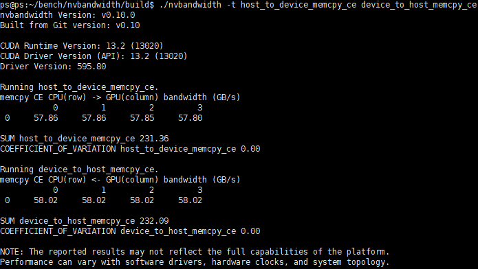

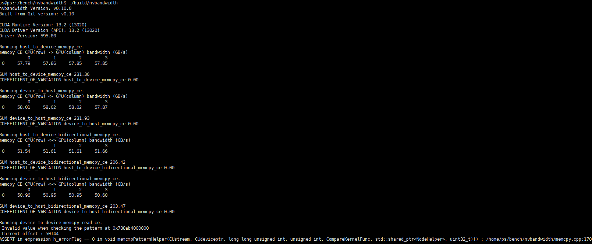

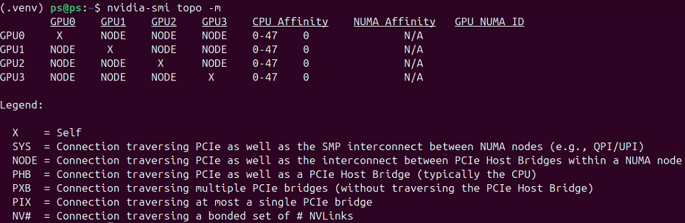

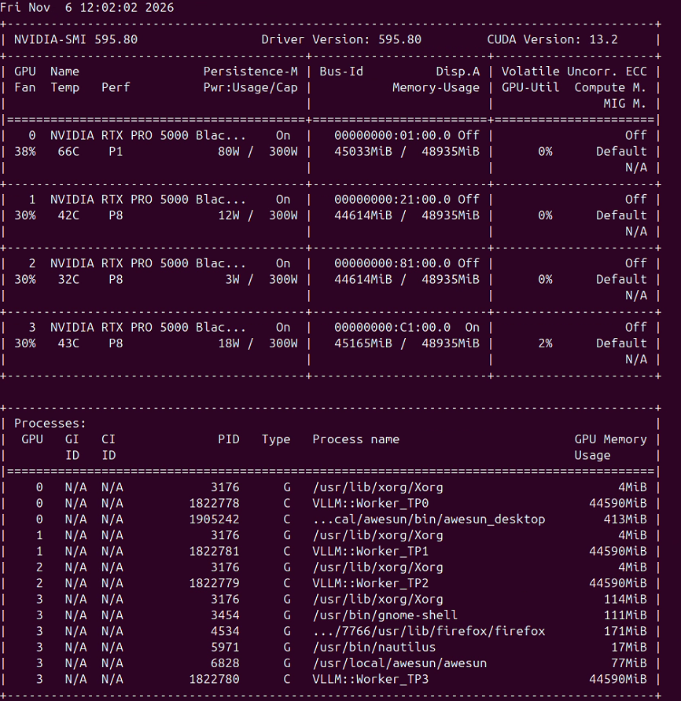

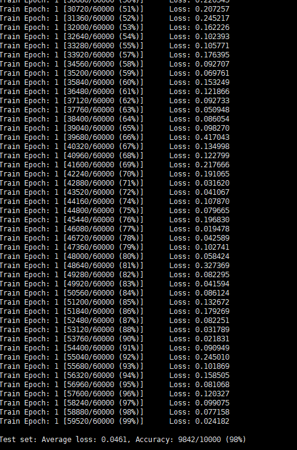

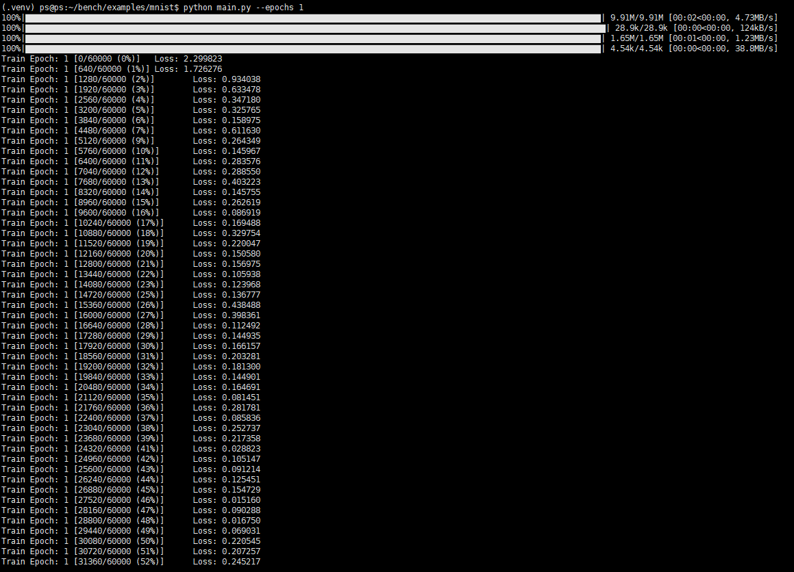

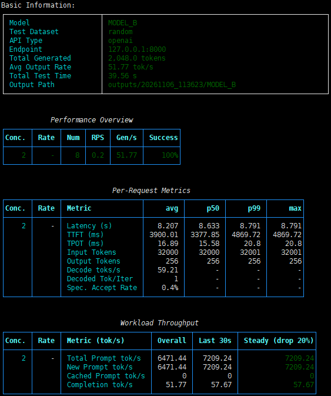

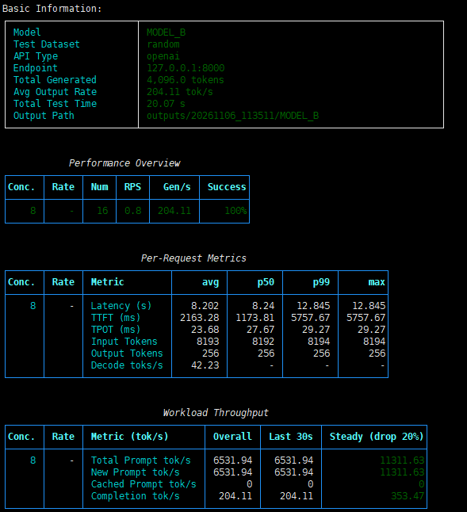

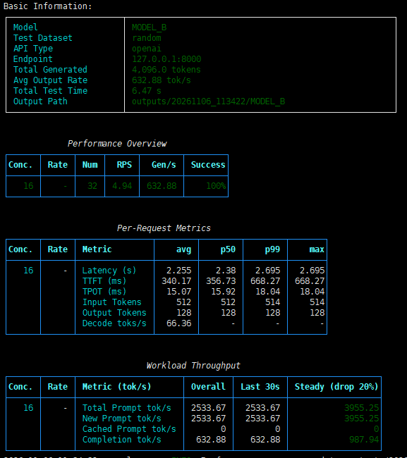

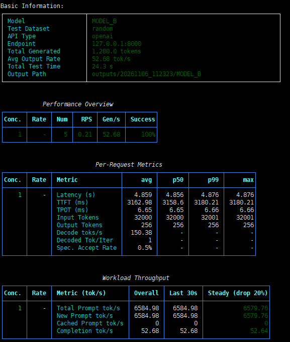

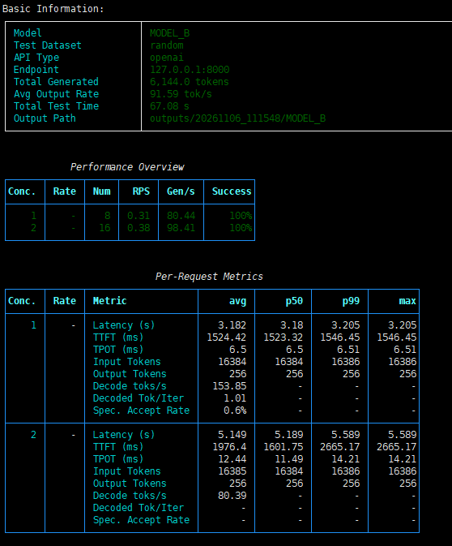

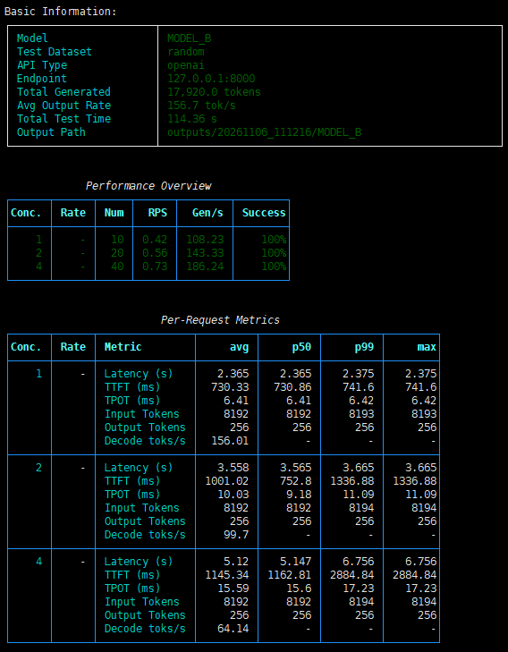

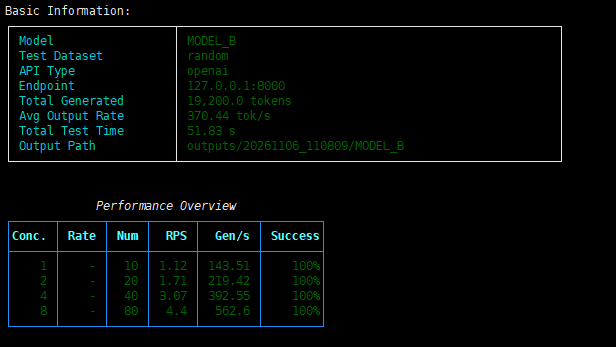

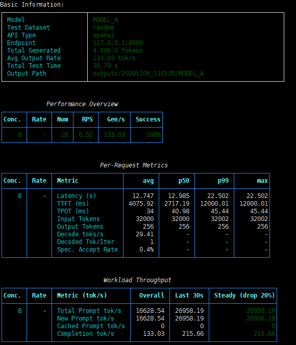

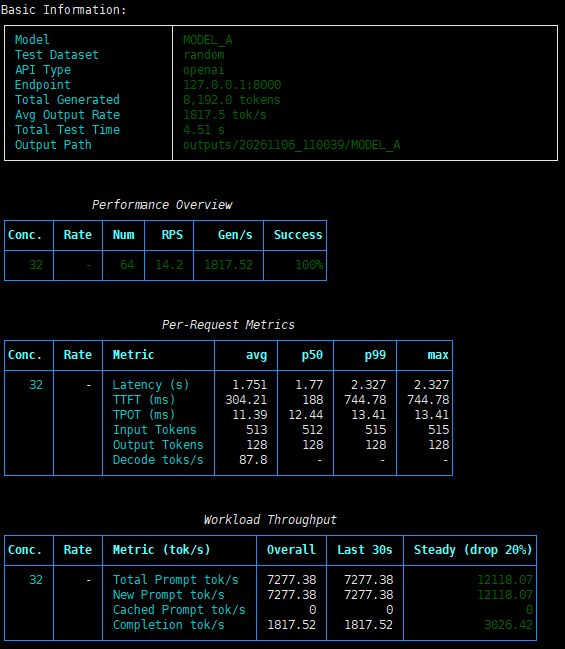

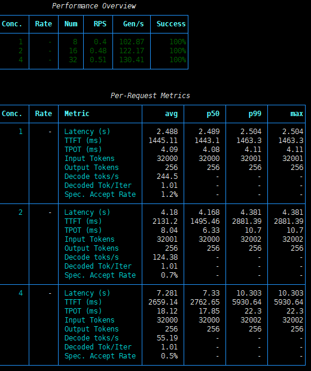

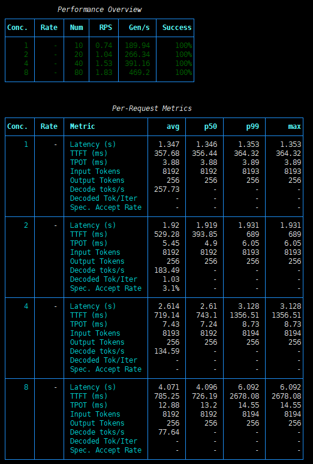

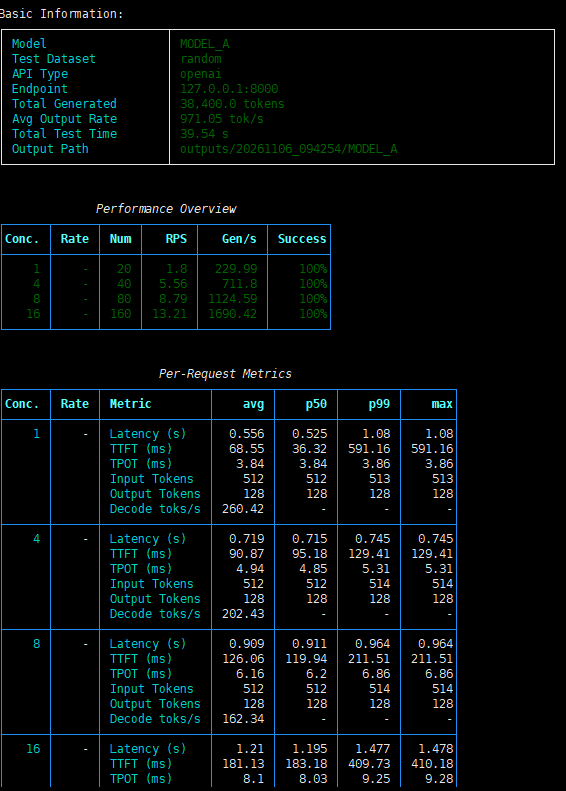

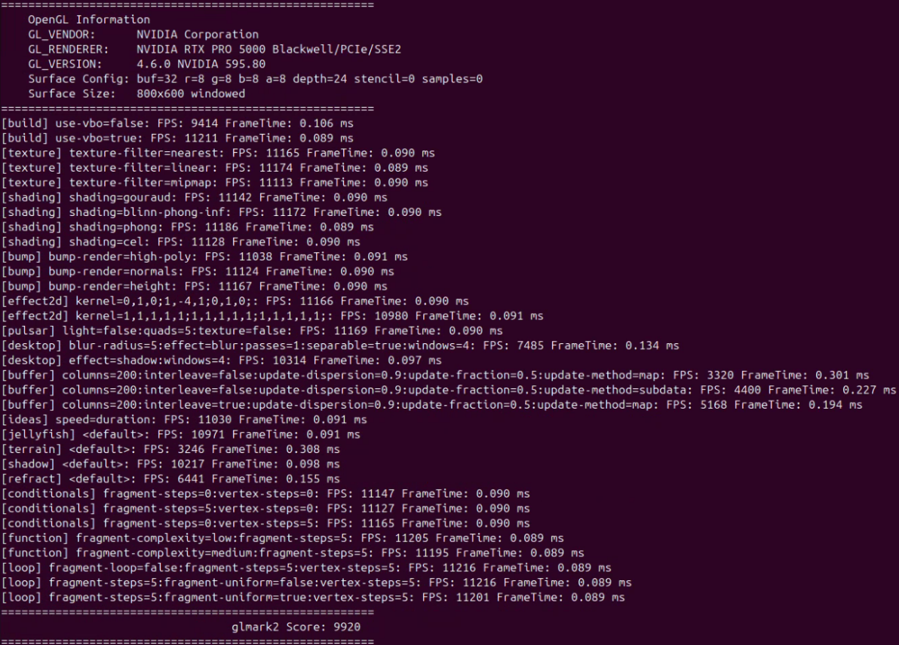
