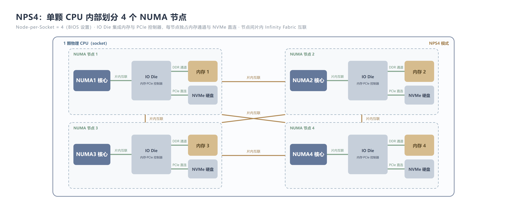
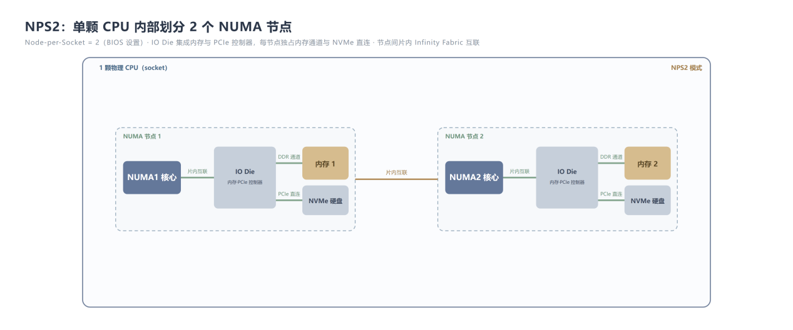
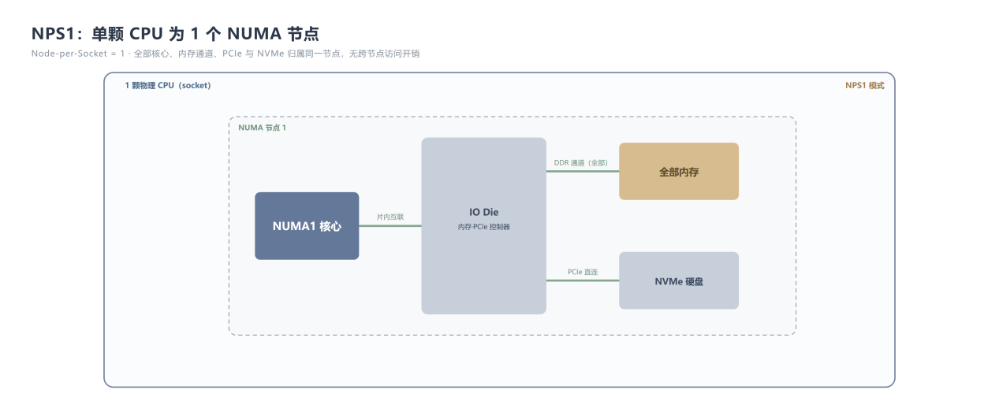

# NUMA技术

NUMA（非统一内存访问）是多路服务器的标准内存架构。以 AMD EPYC 为例，一颗 CPU 可以通过在内部划分为 4 个 NUMA 节点。每个节点拥有自己的一组核心、内存和 NVMe 直连硬盘，由 IO Die 统一负责内存与 PCIe 数据的调度：核心访问本节点的内存延迟最低；需要跨节点时，也可以通过片内互联通道共享资源，速度稍慢。划分之后各节点独立工作、互不干扰，服务器规模扩大后性能依然稳定。

> 本文档含 3 张插图，见 `assets/NUMA技术/`。

